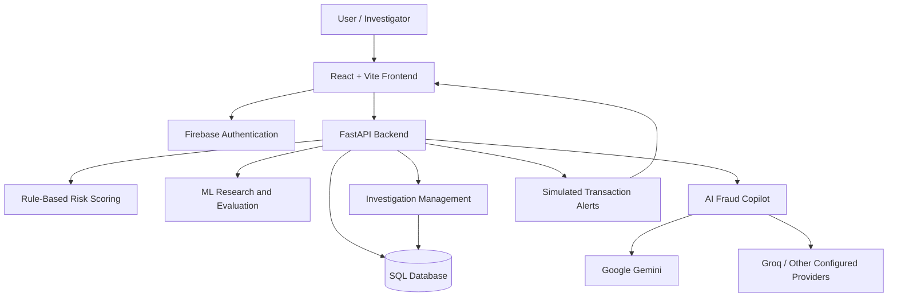

# 🛡️ FraudShield AI

### AI-Powered UPI Fraud Detection & Investigation Platform

**An intelligent full-stack academic project for simulated UPI
fraud detection, transaction risk analysis, and AI-assisted
financial investigations.**


---

## 📌 Project Overview

FraudShield AI is an AI-assisted financial security platform
designed to detect, analyze, and investigate potentially
suspicious UPI payment transactions in a controlled sandbox.

The platform combines:

- Rule-based transaction risk scoring
- Experimental machine learning fraud classification
- AI-powered investigation explanations
- Transaction analytics and visualizations
- QR payment inspection
- Investigation case management
- Firebase Authentication and role-based access
- AI-generated investigation reports

The purpose is not only to identify suspicious activity but
also to help investigators understand risk indicators and
make informed decisions.

> **Disclaimer:** FraudShield AI is an academic research
> prototype using synthetic transactions. It does not
> connect to real banking systems, process actual UPI
> payments, or automatically block accounts.

---

## 🎯 Problem Statement

As digital payments become increasingly common,
fraudulent payment requests, phishing, impersonation,
and suspicious transaction behavior present significant
financial security challenges.

Traditional rule-based systems can identify known warning
signs but may struggle with changing patterns and complex
combinations of transaction behavior.

FraudShield AI demonstrates an integrated environment
for risk assessment, machine learning experimentation,
and human-centered fraud investigations.

---

## 🚀 Objectives

1. Simulate and analyze UPI transactions.
2. Identify suspicious transaction patterns.
3. Perform research using machine learning algorithms.
4. Provide understandable explanations of risk indicators.
5. Support human investigators with AI-generated guidance.
6. Manage investigation cases and audit information.
7. Visualize transaction trends and risk classifications.
8. Implement authenticated, role-based access.
9. Support investigation documentation and reporting.

---

## ✨ Core Features

### 1. UPI Transaction Simulator

- Simulate UPI payment requests.
- Evaluate transaction amount and historical behavior.
- Identify unusual transaction timing and frequency.
- Check whether the recipient is new.
- Display risk scores and associated explanations.

### 2. Transaction Analytics

- View simulated transaction history.
- Monitor transaction risk distribution.
- Explore analytics and fraud indicators.

### 3. Machine Learning Research

- Train models on synthetic fraud data.
- Compare classification models.
- Analyze evaluation metrics.
- Study model performance on unseen test data.

### 4. Investigation Management

- Review suspicious transactions.
- Track investigation statuses.
- Maintain analyst notes and audit information.
- Support role-based investigation workflows.

### 5. AI Fraud Copilot

- Explain transaction risk indicators.
- Recommend safe investigation steps.
- Support AI-generated investigation reports.
- Analyze synthetic or redacted scam screenshots.

### 6. Security

- Firebase Authentication.
- Role-based access control.
- Protected investigation and administrator operations.

### 7. QR Inspector

- Inspect payment-related QR or UPI information.
- Support checks for suspicious payment requests.

---

## 🏗️ System Architecture



**Architecture explanation:**

React provides the user interface. FastAPI processes requests
and performs transaction analysis. The SQL database stores
transaction and investigation data.

Firebase supports identity verification and access control.
The ML research pipeline evaluates classification algorithms.
External generative AI providers assist with explanations
and investigation reports.

AI recommendations require human review.

---

## 🧰 Technology Stack

| Layer                    | Technology                              |
| ------------------------ | --------------------------------------- |
| Frontend                 | React.js, JavaScript, Vite, CSS         |
| Backend                  | Python, FastAPI                         |
| Database                 | SQLAlchemy, SQLite / PostgreSQL support |
| Authentication           | Firebase Authentication                 |
| Machine Learning         | Scikit-learn, Pandas, NumPy             |
| Generative AI            | Google Gemini, Groq, OpenAI integration |
| Live Communication       | WebSockets                              |
| Version Control          | Git, GitHub                             |
| Deployment Configuration | Docker, Docker Compose                  |

---

## 📊 Machine Learning Methodology

The machine learning module uses synthetic transaction
data for model training and evaluation.

### General workflow

1. Load and inspect synthetic transaction data.
2. Prepare relevant features and target labels.
3. Split data into training and evaluation sets.
4. Train candidate classification algorithms.
5. Evaluate the models using appropriate metrics.
6. Compare model performance and limitations.

### Important features

- Transaction amount
- Typical transaction amount
- Recent transaction frequency
- Transaction hour
- New recipient indicator

### Evaluation metrics

- Accuracy
- Precision
- Recall
- F1-score
- Confusion matrix
- Other metrics produced by the research pipeline

**Important distinction:**

The live UPI sandbox demonstrates rule-based risk scoring.
The machine learning models are maintained as a research
and comparison component. They should not be represented
as the live production decision engine without explicit
integration and validation.

### Dataset

`data/original_synthetic_fraud.csv`

The dataset is synthetic and intended for academic research.
Its performance results must not be interpreted as proof of
accuracy on real-world banking transactions.

---

## 📸 Application Screenshots

Add actual screenshots from your running application
to the `docs/screenshots/` folder.

Recommended screenshots:

1. Overview dashboard   :  [C:\Users\moham_ji328n6\OneDrive\Desktop\FraudShield-AI\docs\screenshorts\dashboard.png]
2. UPI transaction simulator : [C:\Users\moham_ji328n6\OneDrive\Desktop\FraudShield-AI\docs\screenshorts\upi-simulator.png]
3. Transaction analytics : [C:\Users\moham_ji328n6\OneDrive\Desktop\FraudShield-AI\docs\screenshorts\Transaction-History.png]
4. Analysis : [C:\Users\moham_ji328n6\OneDrive\Desktop\FraudShield-AI\docs\screenshorts\analytics.png]
5. Investigation management : [C:\Users\moham_ji328n6\OneDrive\Desktop\FraudShield-AI\docs\screenshorts\investigation.png]
6. Ml Research : [C:\Users\moham_ji328n6\OneDrive\Desktop\FraudShield-AI\docs\screenshorts\Ml Research.png]
7. AI Fraud Copilot : [C:\Users\moham_ji328n6\OneDrive\Desktop\FraudShield-AI\docs\screenshorts\Ai assistence.png]
8. Reports : [C:\Users\moham_ji328n6\OneDrive\Desktop\FraudShield-AI\docs\screenshorts\reports.png]
9. Security and authentication : [C:\Users\moham_ji328n6\OneDrive\Desktop\FraudShield-AI\docs\screenshorts\login.png]

Screenshots should use fictional or redacted data.

---

## 📁 Project Structure

```text
FraudShield-AI/
├── backend/
│   ├── app/
│   │   ├── main.py
│   │   ├── db.py
│   │   ├── security.py
│   │   ├── copilot.py
│   │   └── advanced.py
│   ├── models/
│   ├── tests/
│   └── requirements.txt
│
├── frontend/
│   ├── src/
│   ├── package.json
│   └── index.html
│
├── ml/
│   ├── train.py
│   ├── train_sandbox.py
│   └── compare_models.py
│
├── data/
│   └── original_synthetic_fraud.csv
│
├── docs/
├── README.md
├── compose.yaml
└── .gitignore
```

The structure may contain additional components in
newer development branches.

---

## ⚙️ Installation and Setup

### Prerequisites

- Python
- Node.js and npm
- Git
- A configured Firebase project
- Optional API keys for external AI providers

### 1. Clone the repository

```bash
git clone https://github.com/MohammedAzamAli/FraudShield-AI.git
cd FraudShield-AI
```

### 2. Backend setup (Windows PowerShell)

```powershell
cd backend
python -m venv .venv
.\.venv\Scripts\Activate.ps1
python -m pip install -r requirements.txt
```

Create `backend/.env` using the provided example
configuration and your own credentials.

Never commit `.env` or service-account credentials.

Start FastAPI:

```powershell
python -m uvicorn app.main:app --reload
```

Backend URL:

`http://127.0.0.1:8000`

API documentation:

`http://127.0.0.1:8000/docs`

### 3. Frontend setup

Open a new terminal:

```powershell
cd frontend
npm install
```

Create `frontend/.env` using `frontend/.env.example`
and configure your Firebase frontend settings.

Start React:

```powershell
npm run dev
```

Frontend URL:

`http://127.0.0.1:5173`

### 4. Authentication setup

Refer to:

`FIREBASE_SETUP.md`

Firebase authentication must be configured using
your own project credentials.

Administrator roles must be assigned through
the authorized project setup workflow.

### 5. AI provider configuration

Set the supported provider API keys in
your backend environment file.

AI features may be unavailable if provider
billing, quotas, permissions, or connectivity
are insufficient.

Do not upload actual customer financial data
to external AI services.

---

## 🧪 Testing

Run backend tests:

```powershell
cd backend
.\.venv\Scripts\python.exe -m pytest -q
```

Run frontend build verification:

```powershell
cd frontend
npm run build
```

Test outcomes depend on installed dependencies,
configured services, and the selected release.

---

## 🔐 Security Considerations

- API keys and credentials must remain outside Git.
- Authentication is handled through Firebase.
- Protected actions require authorization.
- Only synthetic or appropriately redacted
  information should be supplied to AI providers.
- AI-generated results are advisory.
- Production deployment requires additional
  security testing and access-control verification.

---

## ⚠️ Limitations

- Synthetic data may not represent real-world fraud.
- Live sandbox scoring uses predefined rules.
- External AI services can experience downtime.
- AI-generated explanations may contain errors.
- The application is not connected to real
  UPI payment infrastructure.
- Real-world deployment requires validation,
  compliance review, and security hardening.

---

## 🗺️ Version History

| Version | Summary                                                                                                          |
| ------- | ---------------------------------------------------------------------------------------------------------------- |
| v10.0.0 | Firebase authentication, transaction sandbox, investigations and Multi-AI Copilot                                |
| v11.0.0 | In development: AI history, provider reliability, monitoring, reporting, notifications and security improvements |

See GitHub Releases for published stable versions.

---

## 🔮 Future Scope

- Real-world model validation
- Improved fraud classification and anomaly detection
- Model drift detection
- Explainable ML techniques
- Advanced security auditing
- Scalable transaction processing
- Investigator feedback and active learning
- Production infrastructure integration

---

## 🎓 Academic Project

**Project:** FraudShield AI

**Category:** Artificial Intelligence / Machine Learning /
Financial Cybersecurity

**Project Type:** Final-Year Engineering Major Project

**Development Approach:** Full-stack application,
synthetic ML research, and AI-assisted investigation

---

## 📜 License

No open-source license has been selected yet.

The repository may be publicly viewable without
granting permission to reuse or redistribute its code.

---

**FraudShield AI — Detect Risk. Investigate Smarter.**

```

```
